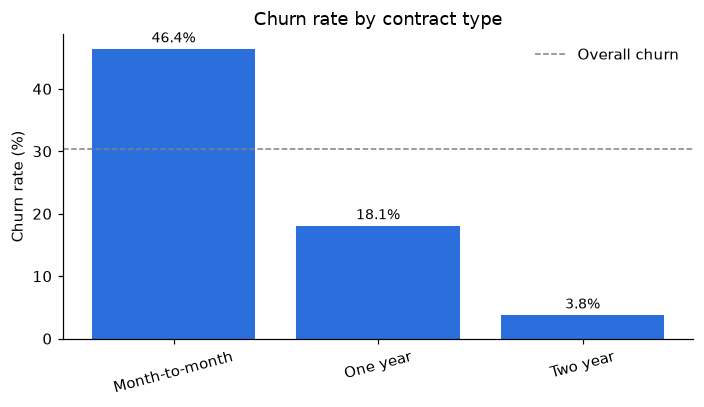
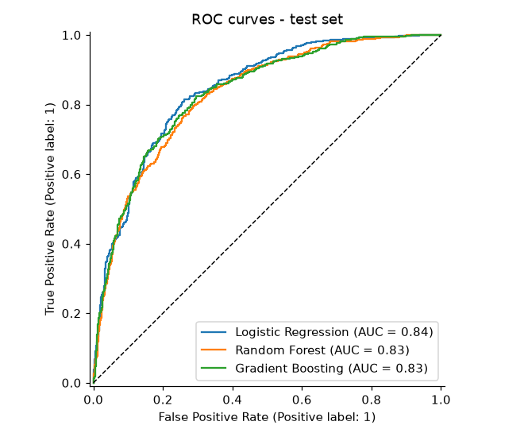
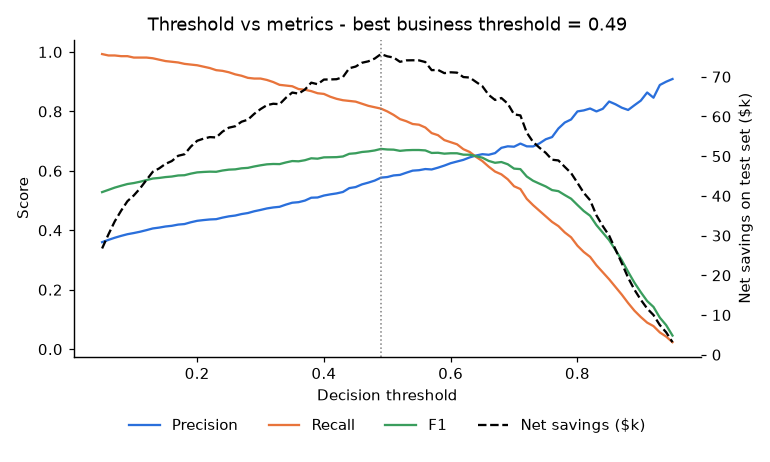

# 📉 Customer Churn Prediction & Retention Analytics

An end-to-end **Data Analysis → Data Science → Machine Learning** project that predicts which telecom customers are likely to leave, explains *why*, and turns the model into a **business decision** (who should get a retention offer) through an interactive **Streamlit** web app.

   

---

## 🎯 Problem statement
Acquiring a new customer costs 5-7× more than keeping an existing one. The goal is to:
1. **Analyse** customer data to find the main drivers of churn.
2. **Predict** each customer's probability of churning with machine learning.
3. **Decide** which customers to target with a retention offer to maximise net savings.

## 📊 Results at a glance
| Metric (hold-out test set, 1,400 customers) | Value |
|---|---|
| Best model | Logistic Regression (beat Random Forest & Gradient Boosting) |
| ROC-AUC | **0.843** |
| Recall (churners caught) | **80%** |
| Precision | 58% |
| F1-score | 0.67 |
| Business-optimised threshold | 0.49 |
| Estimated net savings from targeted retention (test set) | **≈ $75,700** |

**Top churn drivers:** contract type, tenure, total charges, internet service type, number of support tickets.

## 🔍 Key insights from EDA
- Overall churn rate is **30.4%**.
- **Month-to-month** customers churn at **46.4%** vs only **3.8%** on two-year contracts.
- The **first 12 months** are the highest-risk period.
- **Fiber optic** and **electronic-check** customers churn noticeably more.
- Churned customers raise more **support tickets**, an early warning signal.

Full write-up: [`reports/eda_insights.md`](reports/eda_insights.md)

| Churn by contract | Feature importance |
|---|---|
|  |  |
| **ROC curves** | **Threshold vs business savings** |
|  |  |

## 🛠️ What the project covers
| Stage | Techniques |
|---|---|
| **Data cleaning** | Type conversion, missing-value imputation, duplicate removal, category standardisation |
| **EDA** | Univariate/bivariate analysis, churn-rate segmentation, distributions, correlation matrix |
| **Feature engineering** | Service count, average monthly spend, tenure groups, new-customer flag, tickets per year, family flag |
| **Modelling** | scikit-learn `Pipeline` + `ColumnTransformer`, Logistic Regression, Random Forest, HistGradientBoosting, class-imbalance handling |
| **Validation** | Stratified 5-fold cross-validation, hold-out test set, `RandomizedSearchCV` hyper-parameter tuning |
| **Evaluation** | ROC-AUC, precision, recall, F1, confusion matrix, permutation feature importance |
| **Business layer** | Cost-benefit threshold optimisation (offer cost vs customer lifetime value) |
| **Deployment** | Streamlit app (single prediction + batch CSV scoring + insights dashboard), CLI batch scoring |
| **Engineering** | Modular code, config file, unit tests with `pytest`, reproducible seeds |

## 📁 Project structure
```
customer-churn-prediction/
├── app/streamlit_app.py      # Interactive web app
├── data/
│   ├── generate_data.py      # Creates the dataset (7,000 customers)
│   └── raw/telco_customers.csv
├── models/                   # Saved model (created by main.py)
├── reports/
│   ├── figures/              # All charts (EDA + evaluation)
│   ├── eda_insights.md       # Written analysis & recommendations
│   ├── metrics.json          # Final model metrics
│   ├── model_comparison.csv
│   └── feature_importance.csv
├── src/
│   ├── config.py             # Paths & business assumptions
│   ├── data_prep.py          # Cleaning & feature engineering
│   ├── eda.py                # Exploratory analysis & charts
│   ├── train.py              # Model training, CV, tuning
│   ├── evaluate.py           # Evaluation & threshold optimisation
│   └── predict.py            # Batch scoring CLI
├── tests/test_pipeline.py
├── main.py                   # Runs the whole pipeline
└── requirements.txt
```

## 🚀 How to run
```bash
git clone https://github.com/<your-username>/customer-churn-prediction.git
cd customer-churn-prediction
python -m venv .venv
# Windows: .venv\Scripts\activate   |   macOS/Linux: source .venv/bin/activate
pip install -r requirements.txt

python main.py                         # data -> EDA -> train -> evaluate (≈1 min)
streamlit run app/streamlit_app.py     # open the web app
pytest                                 # run the tests
```
Score any CSV of customers:
```bash
python -m src.predict --input data/raw/telco_customers.csv --output reports/scored_customers.csv
```

## 📦 About the data
The dataset (7,000 customers, 20 columns) is generated by `data/generate_data.py`, modelled on the structure of real telecom churn data (contracts, services, billing, support tickets). It deliberately includes real-world data-quality problems (blank values, duplicates, inconsistent labels) to demonstrate data cleaning. The same pipeline works on the public **IBM Telco Customer Churn** dataset after renaming its columns to snake_case.

## 💡 Business recommendations
1. Offer discounts to move month-to-month customers to 1-2 year contracts.
2. Run a structured onboarding programme during the first year.
3. Bundle free tech support / online security for high-risk fiber customers.
4. Encourage auto-pay instead of electronic checks.
5. Trigger proactive outreach when support tickets rise.

## 🔮 Future work
- SHAP values for per-customer explanations
- Survival analysis to predict *when* a customer will churn
- Deploy on Streamlit Community Cloud with CI via GitHub Actions

## 📄 License
MIT
