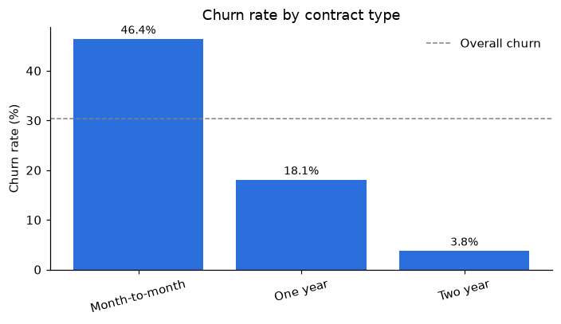
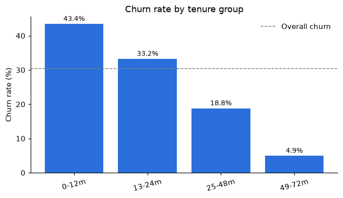

# EDA Insights

## Data quality
| Check | Result |
|---|---|
| Rows loaded | 7,035 |
| Blank `total_charges` fixed (new customers) | 159 |
| Duplicate rows removed | 35 |
| Inconsistent `payment_method` labels | normalised (trimmed + recased) |
| Final rows | 7,000 |

## Key findings
- **Overall churn rate: 30.4%** - the classes are imbalanced, so accuracy alone is misleading; ROC-AUC, recall and F1 are used instead.
- **Contract type is the strongest driver:** month-to-month customers churn at **46.4%** vs **3.8%** on two-year contracts.
- **Early tenure is the riskiest period:** customers in their first 12 months churn at **43.4%**, compared with **4.9%** after 4+ years.
- **Fiber optic users churn more** (**43.7%**) than DSL (**24.1%**) - possible price/quality issue worth investigating.
- **Electronic check payers churn at 36.0%**, the highest of any payment method; auto-pay customers are stickier.
- **No tech support -> 37.8% churn** vs 30.9% with tech support.
- Churned customers raised **1.96** support tickets on average vs **1.32** for retained customers.
- **Monthly revenue lost to churn: $164,280**.

## Business recommendations
1. Offer discounts to move month-to-month customers onto 1-2 year contracts.
2. Build a structured onboarding programme for the first 12 months.
3. Bundle free tech support / online security for high-risk fiber customers.
4. Incentivise switching from electronic check to auto-pay.
5. Flag customers with rising support tickets for proactive outreach.

